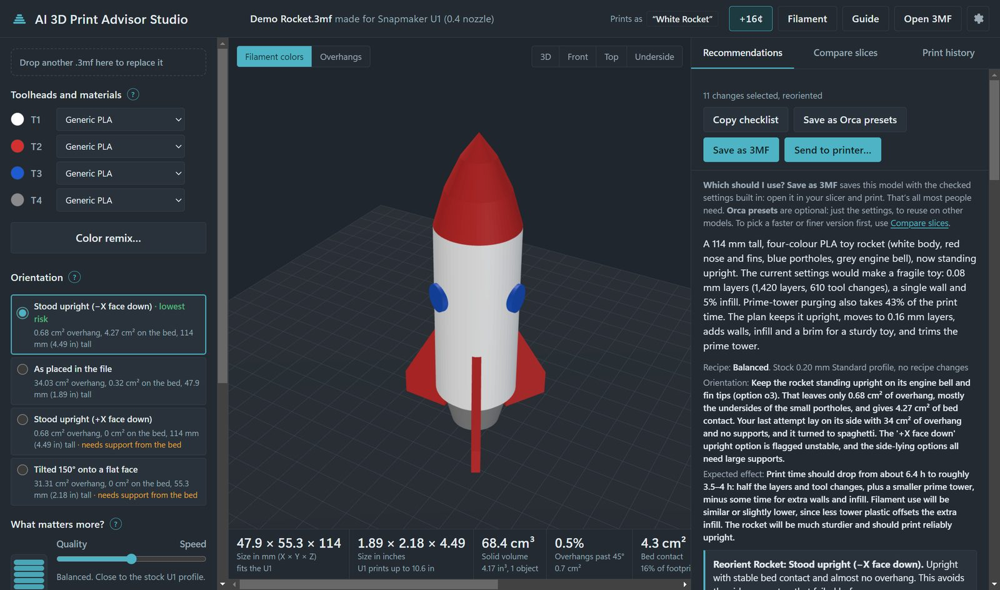
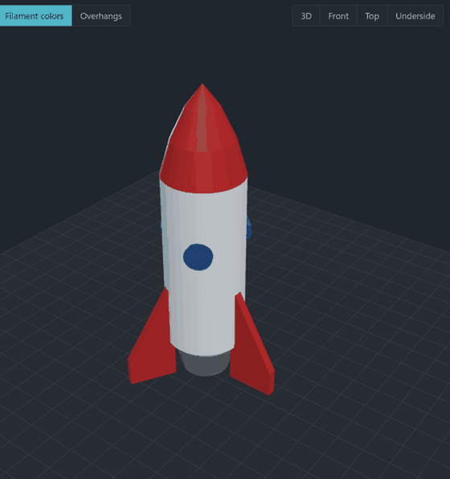
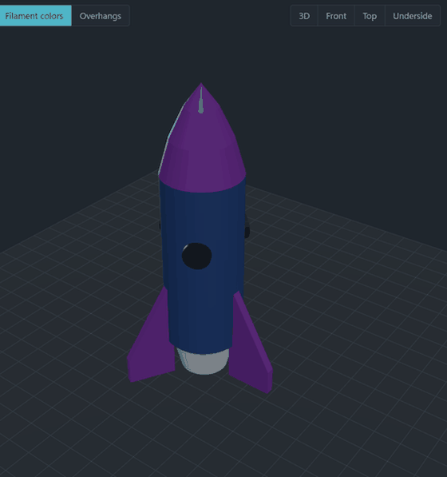
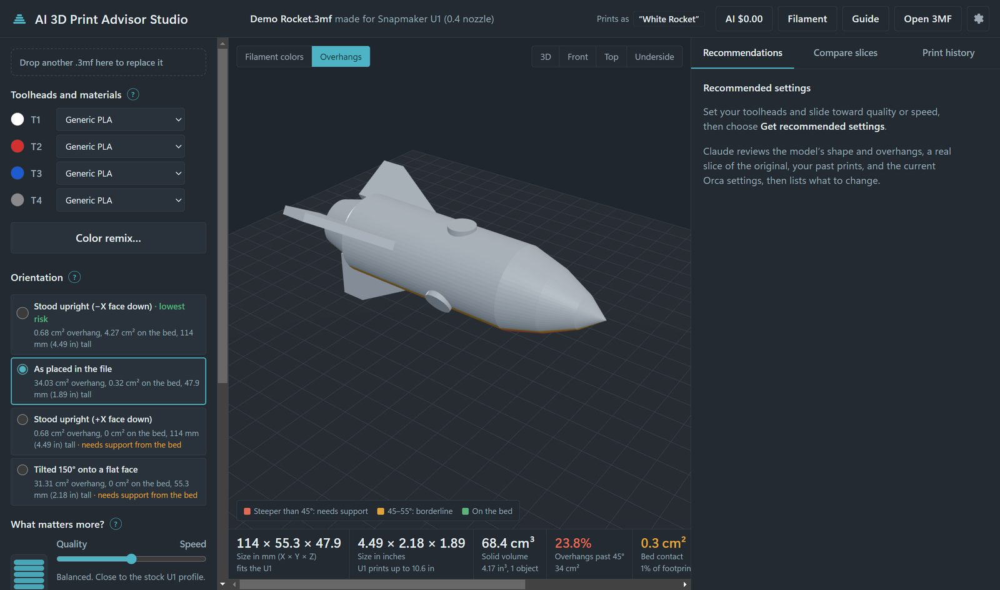
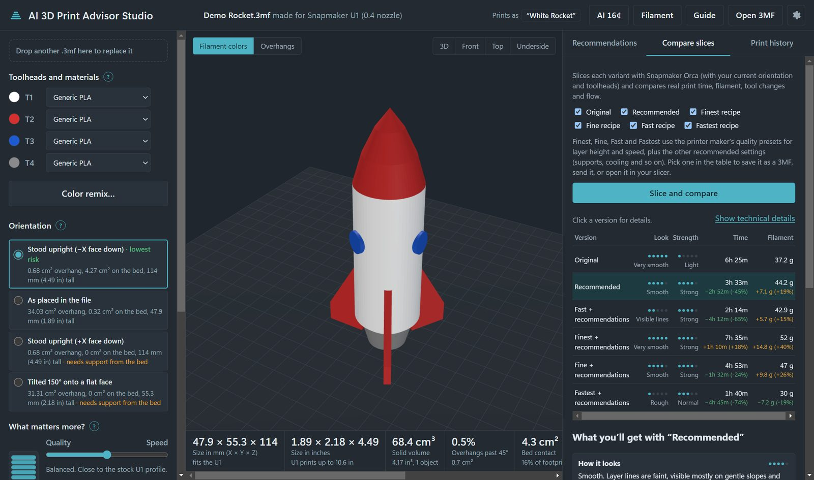
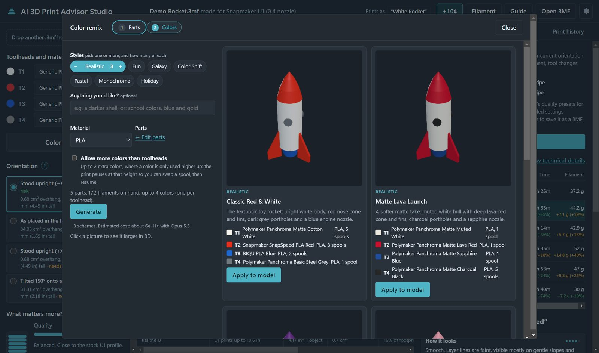
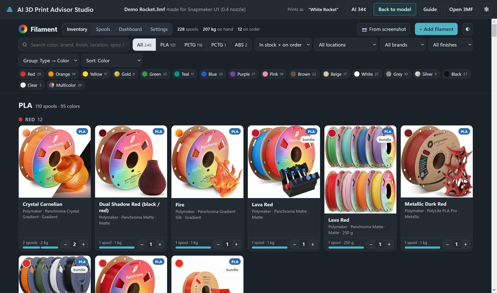
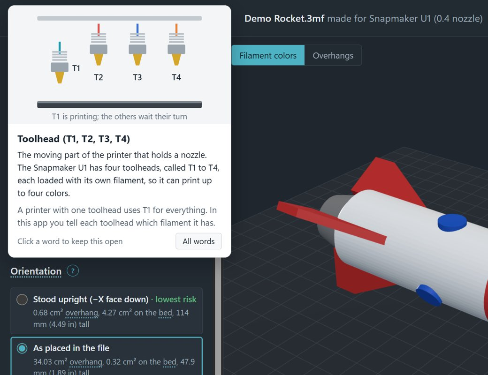
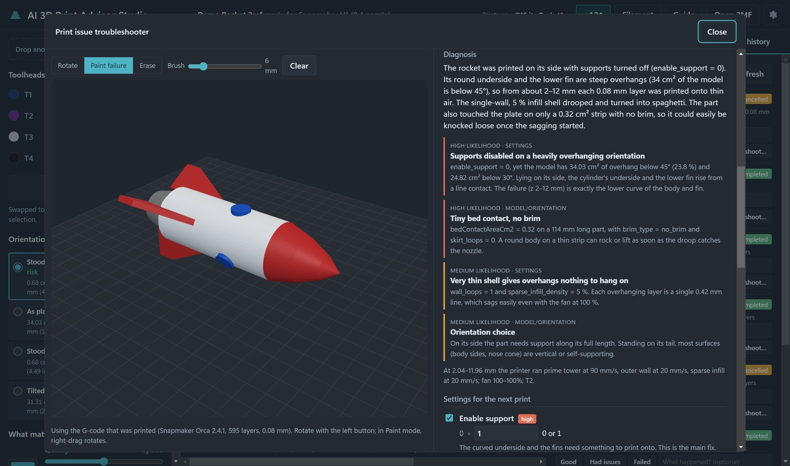

# AI 3D Print Advisor Studio

**A free Windows app that helps you get good 3D prints on your first try.**

You open a 3D model (a `.3mf` file, like the ones you download from MakerWorld or Printables). The app:

- **checks the model** and shows where it would print over thin air,
- **finds the best way to place it** on the print bed,
- **asks an AI (Claude) for the right settings** and explains every change in plain words,
- **shows you what each version will look like**, how strong it will be and how long it takes,
- **recolors multi-color models** with the filament you actually own,
- **converts MakerWorld and Bambu Lab files** for your printer, and saves Bambu Studio versions of your U1 models to **share on MakerWorld**,
- **sends the print to your printer**,
- and **helps you figure out what went wrong** when a print fails: mark where it failed on the 3D model and get likely causes and fixes.

It also keeps a **filament library**: every spool you own, with photos, colors, where it's stored and how much is left. With a USB NFC reader you can **tap a spool's tag** (Bambu Lab, Snapmaker, Creality, QIDI, Anycubic, ELEGOO and more) to open or add it.

**Made for beginners:** an optional **guided tour** walks you through everything on a sample model, and a **sample filament library** lets you see the Filament screen in action before you add your own. Every recommendation says *why*, so you learn as you go. Words like "brim" or "infill" are explained when you hover over them, the **Glossary** has a picture for every term, and there's a **printable booklet** to keep next to your printer. Not sure where to get models? **Find models** lists the best free and paid sites, starting with **Snapmaker Space** (ready-to-print U1 files). The app **updates itself** with one click.

### Free, with no middleman

- **The app is completely free.** No subscription, no license, no account with the developer, no ads.
- **For the AI features, your own Anthropic (Claude) API key is highly recommended.** It's pay-as-you-go and inexpensive: most analyses cost a few cents (about $0.04–0.10), so $5 of credit lasts 60 or more. There's no subscription.
- **You set it up and manage it yourself**, directly with Anthropic (the app shows you how the first time it starts). The app talks straight from your PC to Anthropic: there's no server or person in between, and the developer never sees your key, your models or your data. Your key is stored encrypted on your PC.
- **Don't want to pay at all?** Use the free **chatbot mode**: the app gives you a prompt to paste into ChatGPT, Claude or Gemini (free plans work) and you paste the answer back.

It's made for the **Snapmaker U1** with **Snapmaker Orca** (Snapmaker's slicer), and it can also save projects for **Bambu Lab** printers to share on MakerWorld.

 

---

## 👉 Install

**What you need**

| | |
|---|---|
| **Windows 10 or 11** (64-bit) | The app is a normal Windows program. Nothing to install: it runs from its folder. |
| **Snapmaker Orca** | Snapmaker's free slicer. The app uses it to "slice" (prepare) your models. [Download Snapmaker Orca](https://www.snapmaker.com/) if you don't have it. |
| **AI help**, one of: | |
| • an **Anthropic API key** (automatic, a few cents per request) | The app asks Claude directly. See [Getting an API key](docs/USER-GUIDE.md#getting-an-anthropic-api-key). |
| • or **any free chatbot** (ChatGPT, Claude, Gemini) | The app gives you a prompt to copy into the chatbot, and you paste the answer back. Free, just one extra step. |

**Steps**

1. Go to the **[latest release](https://github.com/jtroberts83/AI-Print-Advisor-Studio/releases/latest)**.
2. Download **`AI-3D-Print-Advisor-Studio-win-x64.zip`** ([direct link to the newest](https://github.com/jtroberts83/AI-Print-Advisor-Studio/releases/latest/download/AI-3D-Print-Advisor-Studio-win-x64.zip)).
3. Right-click the zip → **Properties** → tick **Unblock** → **OK**. (This stops the "Windows protected your PC" warning. No Unblock box? Skip this step.)
4. Right-click the zip → **Extract All…**. Pick a place you'll find again, like your **Documents** folder.
5. Open the folder and double-click **`AI 3D Print Advisor Studio.exe`**, the only program in it. Leave the `app` folder next to it. (Tip: right-click it → **Send to → Desktop (create shortcut)**.)
6. **The first time, the app asks how much 3D printing experience you have.** If you're new to it, it offers a **guided tour** (about 10 minutes, optional): every feature on a sample toy rocket, with results recorded from the real app, so nothing is sliced, printed or sent to the AI. Leave it anytime with **Exit the tour**, or take it later from Settings.
7. **A short setup window** then helps with the two things the app needs: the AI (an Anthropic API key just for this app, or the free chatbot instead) and Snapmaker Orca. Click **Later** to do it in Settings (the gear, top right), where you also add your printers.
8. **The first time you open Filament**, choose to **explore the sample library** (a real collection of about 240 spools with photos) or **start with an empty one**. When you're done exploring, remove the samples in Settings (Filament library): anything you added yourself stays.

> **Windows may show "Windows protected your PC."** That's normal for free apps from small developers that haven't paid for a code-signing certificate. Click **More info**, then **Run anyway**. To avoid the warning altogether, do the **Unblock** step above before extracting. If you'd like to check the files first, see [Is it safe?](#is-it-safe) below.

**Updates are built in** (from 2.23.0): the app checks GitHub when it starts and once a day. When there's a new version it shows what's new since yours, and **Install and restart** updates it in place, in the same folder, with no new download warnings. Only releases that passed the virus scan are installed, and the download is checked against the published checksum. Your settings, API key, filament and history are kept (they're stored separately). Settings → **Check for updates** checks any time, and you can turn the automatic check off there. Coming from 2.22.0 or older? Download the new zip once by hand; after that it updates itself.

To **uninstall**, delete the folder. Your settings and filament are in `%APPDATA%\AI 3D Print Advisor Studio`; delete that folder too to remove everything.

---

## What it can do

| | |
|---|---|
|  | **Spot problems before you print.** Red areas would be printed over thin air. The app scores every way to place the model and picks the safest. |
|  | **Settings that fit your model.** The AI looks at the model, a real slice and your past prints, then lists what to change and why, in plain words. |
|  | **Compare versions side by side.** Real slices of Fine, Fast, Recommended and more: how it looks, how strong it is, how long it takes, how much filament. |
|  | **Color remix.** Swap a model's colors for filament you own (closest match, shuffle or AI schemes), or let the AI find its parts and design new color schemes. One click applies them. |
|  | **Filament library.** Every spool with photos, colors, location and grams left. Add filament from a screenshot of your order (Amazon or any store). |
|  | **New to 3D printing? Words are explained.** Hover over an underlined word like "brim" or "prime tower" to see what it means, with a drawing. The Glossary button lists them all. |
|  | **Fix failed prints.** Pick a print from your printer's history, mark where it failed, and get the likely causes and the settings to change. |

See **[all features](docs/FEATURES.md)**, the **[user guide](docs/USER-GUIDE.md)**, the one-page **[cheat sheet](docs/CHEAT-SHEET.md)** (printable: [1-page cheat sheet (PDF)](docs/cheat-sheets/AI-3D-Print-Advisor-Cheat-Sheet-1-page.pdf) · [booklet with every word and picture (PDF)](docs/cheat-sheets/AI-3D-Print-Advisor-Booklet.pdf)), the **[FAQ](docs/FAQ.md)** and **[troubleshooting](docs/TROUBLESHOOTING.md)**.

---

## What does the AI cost?

Using an Anthropic API key, a typical request costs **a few cents**: getting recommendations is about 5–20¢ depending on the model you pick. The app shows an estimate before each request, and the **AI** counter at the top shows what you've spent this month (details in Settings → AI spending).

Prefer free? Choose **Free chatbot** in Settings and use ChatGPT, Claude or Gemini in your browser instead.

---

## Your data and privacy

- **Everything stays on your computer**: settings, filament, print history, saved models. There's no account and no server of ours.
- **Your API key** is encrypted with Windows' own protection and only ever sent to Anthropic.
- **What goes to the AI**: when you ask for recommendations, the model's measurements, a few pictures of it, the slicer settings and your recent print history are sent to Anthropic's Claude. Nothing is sent unless you click an AI button.
- **Your printers**: the app talks to them directly on your home network.
- **No tracking, ads or analytics.**

---

## Is it safe?

This is open source: every line of code is here for anyone to read. To help you trust the downloads:

- **Automatic security checks** run on every change ([see them under Actions](https://github.com/jtroberts83/AI-Print-Advisor-Studio/actions)):
  - **CodeQL**: GitHub's code scanner looks for security bugs.
  - **Dependency audit**: checks the libraries the app uses against known vulnerabilities (CVEs).
  - **Secret scan**: makes sure no passwords or keys were committed.
- **Every release is virus-scanned** with ClamAV, and its **SHA-256 checksums** are published with it. You can also upload the zip to [VirusTotal](https://www.virustotal.com/) yourself.
- **Check a download** is exactly what was published: in PowerShell, run
  `Get-FileHash .\AI-3D-Print-Advisor-Studio-win-x64.zip`
  and compare the result with `SHA256SUMS.txt` on the release page.

Found a security problem? See [SECURITY.md](SECURITY.md).

---

## For the technically curious

- Built with **Electron** (the same technology as VS Code and Discord). Source: `main.js` (the app), `preload.js` (the bridge to the window), `renderer/` (the screens), `src/` (slicing, checks, AI, printers, filament).
- AI requests go straight from your computer to `api.anthropic.com` with your key. Printer requests go to your printers' local addresses.
- **Run from source**: install [Node.js](https://nodejs.org/) 22+, then `npm install` and `npm start` in this folder (Electron 45).
- **Build the release folders** (Windows): `python tools/build_release.py --electron <official Electron build, unzipped> --rcedit <rcedit.exe> --out <folder> …`; see the notes at the top of the script. Releases use Electron's own published Windows build (checksum-verified).
- The optional guided tour replays answers recorded from the real app (`preload-demo.js`); the sample rocket is generated by `tools/make_demo_rocket.py` and is public domain (CC0).

## License

[AGPL-3.0](LICENSE). Free to use, study, change and share; if you share a changed version, share its source too.

Not affiliated with Snapmaker, Bambu Lab, Anthropic or MakerWorld. Product names belong to their owners.
