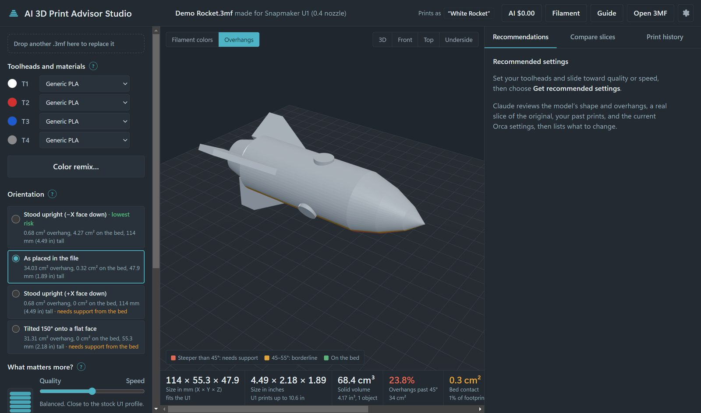
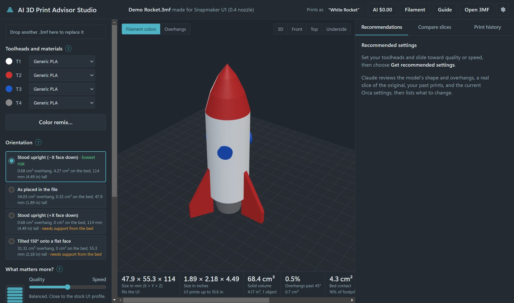
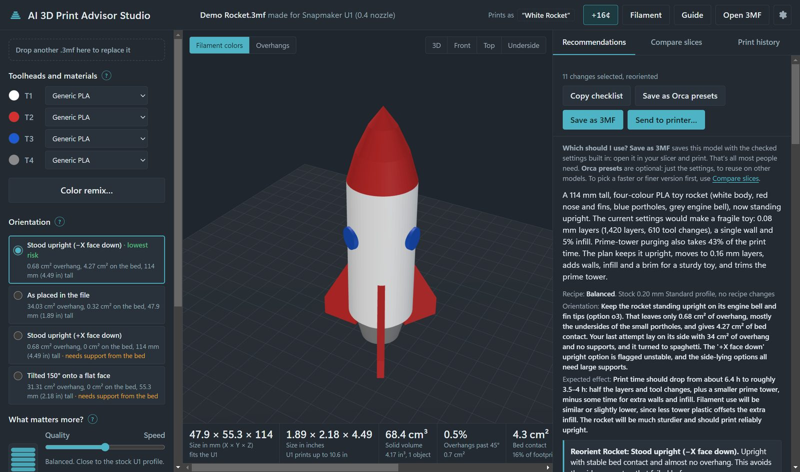
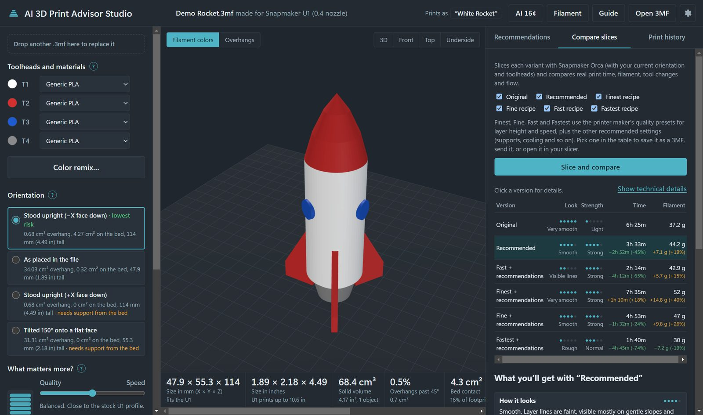
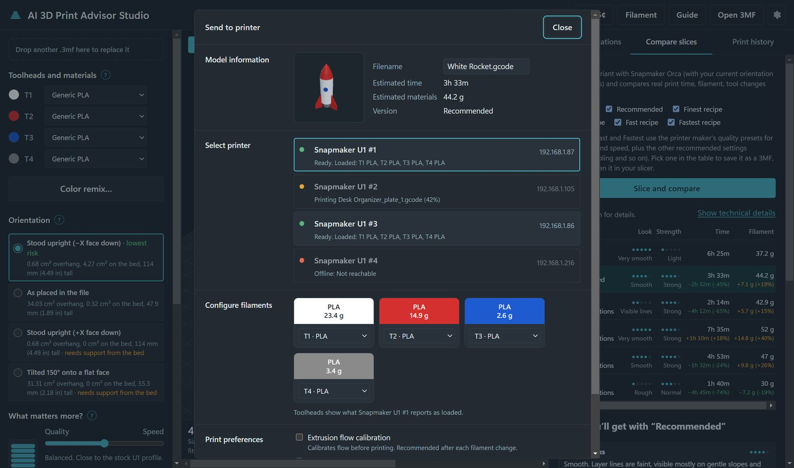
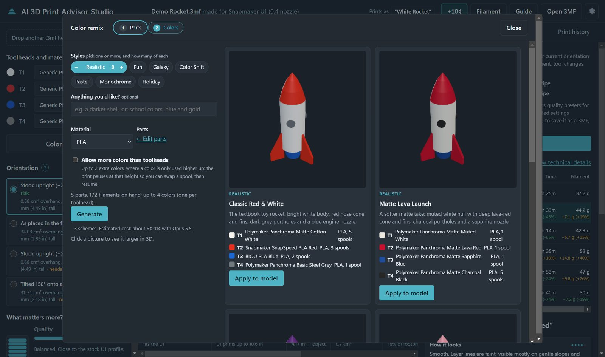
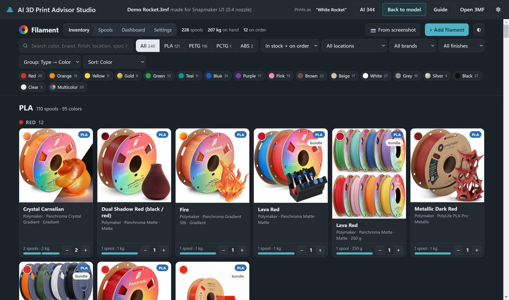
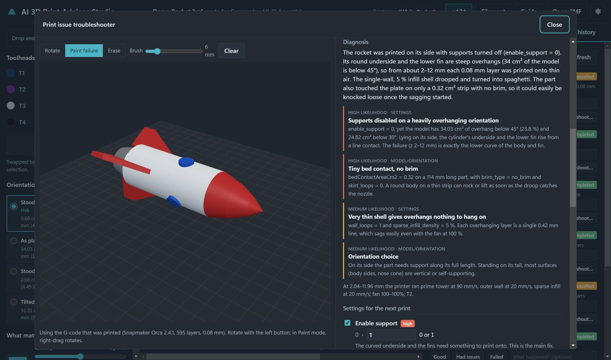
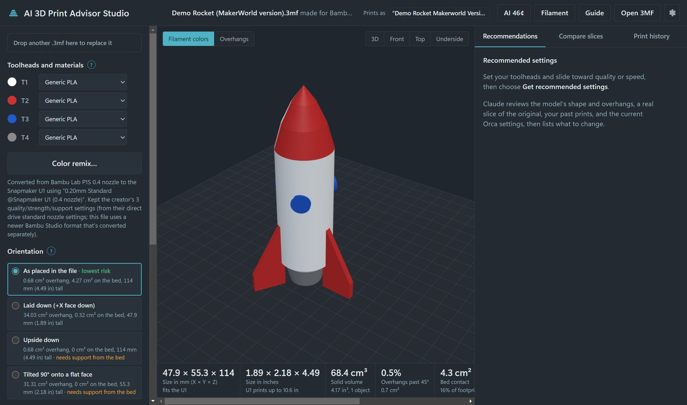
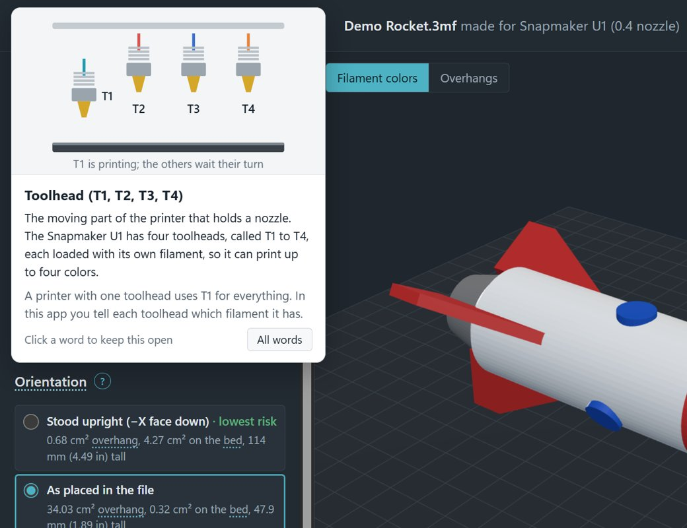

# User guide

This guide takes you from "I downloaded a model" to "it's printing", one step at a time. No 3D printing knowledge needed: every new word is explained in the [glossary](#glossary) at the end.

**Quickest way to learn:** the **guided tour** that starts the first time you open the app. It walks you through all of this with a sample rocket.

---

## Contents

1. [First start](#1-first-start)
2. [Getting an Anthropic API key](#getting-an-anthropic-api-key) (or using a free chatbot)
3. [Open a model](#3-open-a-model)
4. [Check the toolheads (colors)](#4-check-the-toolheads-colors)
5. [Place it on the bed (orientation)](#5-place-it-on-the-bed-orientation)
6. [Choose quality or speed](#6-choose-quality-or-speed)
7. [Get recommended settings](#7-get-recommended-settings)
8. [Compare versions](#8-compare-versions)
9. [Save it or print it](#9-save-it-or-print-it)
10. [Color remix](#10-color-remix)
11. [Your filament library](#11-your-filament-library)
12. [When a print fails: the troubleshooter](#12-when-a-print-fails-the-troubleshooter)
13. [Models from MakerWorld (Bambu Lab files)](#13-models-from-makerworld-bambu-lab-files)
14. [Keeping an eye on AI costs](#14-keeping-an-eye-on-ai-costs)
15. [Glossary](#glossary)

---

## 1. First start

1. Double-click **`AI 3D Print Advisor Studio.exe`**. It's the only program in the folder; the `app` folder beside it holds the app's files (keep the two together if you move them).
   If Windows says **"Windows protected your PC"**, click **More info → Run anyway**. To avoid that warning, right-click the zip **before extracting** → **Properties** → tick **Unblock** → **OK** (see the [FAQ](FAQ.md#windows-says-windows-protected-your-pc)).
2. **The guided tour starts** (first launch only). It asks **how much 3D printing experience you have**, then walks you through every feature on a sample rocket with recorded results, shows you the **Glossary**, and where to put your **API key** (and why). Click **Finish the tour** at the end: the app restarts, ready for your own models, with an empty filament library. It won't run again; **Settings → Take the guided tour again** replays it.
   About the experience level: Pick honestly: "Brand new" turns on the step-by-step guide and extra tips. The guide puts a pulsing orange **Click here** ring on the next button to press (also inside windows like Color remix) and moves itself out of the way. "Brand new" and "A little" also **explain 3D printing words**: words with a dotted underline show what they mean, with a picture, when you hover over them (see [Words you don't know](#words-you-dont-know)). You can change all of this later in Settings.
3. The app looks for **Snapmaker Orca** on your computer. The bar at the top says when it's ready. If it can't find it, open **Settings** (the gear, top right) and click **Browse** next to "Snapmaker Orca program".
4. Click the **gear** to open **Settings** and:
   - choose how to get AI advice (next section),
   - add your **printers** (optional): click **Find printers on my network**, or type each printer's address (the one you'd open Fluidd or Mainsail with, like `192.168.1.50`).

Click **Save**.

---

## Getting an Anthropic API key

The app's AI is **Claude**, made by Anthropic. You can use it two ways:

**A. API key (automatic, a few cents per request)**

1. Go to **[platform.claude.com](https://platform.claude.com/)** and sign up (it's separate from a Claude.ai chat subscription; you don't need one).
2. Under **Billing**, add a little credit. $5 lasts most people a long time.
3. Under **API keys**, click **Create key**, give it a name like "Print Advisor", and **copy** it. It starts with `sk-ant-`.
4. In the app: **Settings → Claude API key** → paste it → **Save**.

Your key is encrypted on your computer and only sent to Anthropic. Treat it like a password: don't share it or post it online.

**B. Free chatbot (copy and paste)**

In **Settings**, pick **Free chatbot**. When you ask for advice, the app shows a prompt: copy it into ChatGPT, Claude or Gemini in your browser, then copy the answer back into the app. Same result, just a little more clicking. (Color remix, the screenshot reader and photo search need an API key.)

---

## 3. Open a model

Drag a **`.3mf`** file onto the window, or click **Open 3MF**. Files from **MakerWorld**, **Printables** and **Snapmaker Orca** all work. Downloaded files are usually in your **Downloads** folder.

The model appears in the middle. **Drag** to turn it, **scroll** to zoom. Under it you'll see its size, how much of it overhangs, how much touches the bed, and more.

> Only have an `.stl` file? Open it in Snapmaker Orca, save it as a project (`.3mf`), then open that here.

---

## 4. Check the toolheads (colors)

On the left, **Toolheads and materials** lists T1 to T4: each toolhead prints one filament. Set each one to the **material** you'll load (PLA is the most common and easiest) and click the **color dot** to match your spool.

If the model needs colors you don't own, a **"What to buy"** box appears with the closest colors you do have, and shop links.

---

## 5. Place it on the bed (orientation)

How a model sits on the bed changes everything. Parts printed over thin air (**overhangs**) droop unless the slicer adds **supports**.

1. Click **Overhangs** above the model. **Red** areas would print over thin air.
2. Look at the **Orientation** list. Each option shows its overhang area, how much touches the bed and its height. **"lowest risk"** is the app's pick.
3. Click an option to try it. The model turns in the 3D view.

| Before: saved lying down, lots of red | After: "Stood upright · lowest risk" |
|---|---|
|  |  |

---

## 6. Choose quality or speed

Under **What matters more?**, slide toward **Quality** (smoother surfaces, slower) or **Speed** (faster, visible lines). The middle is a good everyday choice.

Optionally, tell the app **what the part is for** ("a toy for my kid", "holds weight", "display piece"). The advice takes it into account.

If the parts snap or glue together, tick **These parts fit together** so the app keeps the designer's sizes exactly.

---

## 7. Get recommended settings

Click **Get recommended settings**. The app slices the model to measure it, then asks the AI. It usually takes under a minute.

You get a list of changes. Each row says **what changes**, **from what to what**, and **why**, in plain words. Untick anything you don't want.

**Safety checks** at the top catch settings that wouldn't work and fix many automatically.

---

## 8. Compare versions

Open the **Compare slices** tab, tick the versions you want (Original, Recommended, Finest, Fine, Fast, Fastest), and click **Slice and compare**.

You'll see each version's **look** (smooth or visible lines), **strength**, **print time** and **filament**. Click a version to read what you'll get.

---

## 9. Save it or print it

With a version picked:

- **Save as 3MF**: saves the model with these settings built in. Double-click the file to open it in Snapmaker Orca, check the preview, and print from there.
- **Send to printer…**: uploads straight to one of your printers. Pick the printer, check which spool goes in which toolhead, and click **Print**.
- **Open in slicer**: opens it in Snapmaker Orca right away.

---

## 10. Color remix

Turn a model into new color schemes using **only the filament you own**. There are two ways.

**Swap colors (the quick way, opens first).** The model keeps its painting exactly as it is; each of its colors just gets a different filament from your library. Works on any multi-color model, no parts to find.

1. Click **Color remix…**. Each of the model's colors is listed with how much of the model it covers.
2. Pick a new filament for any color, or click **Closest match** (the filament you own that looks most like each color) or **Shuffle** (a random scheme where light colors stay light and dark ones dark, so eyes and details still stand out). The 3D view shows it as you go. Both are free.
3. Optional: pick styles and click **Suggest schemes** to have the AI design a few (a few cents), then click one to try it.
4. Click **Apply to model**: the toolheads are set to those filaments. Color mixes change with them.

**Recolor by parts (the AI finds the parts).** Use this to color parts differently from how the model was painted, or a model with only one color.

1. Click **Color remix…**, then **Parts** at the top.
2. **Identify parts with AI**: the AI groups the model into parts (body, fins, windows…). Check them by turning the model. Fix a wrong spot by picking the part in the list and clicking or brushing over it.
3. Click **Confirm parts →**.
4. Pick **styles** (Realistic, Fun, Galaxy, Pastel…) and how many of each, then **Generate**.
5. Click a scheme to see it bigger, then **Apply to model**. The colors are painted in and the toolheads are set to your spools.

Changed your mind? Open Color remix again and click **Undo remix** (it undoes a swap too).

---

## 11. Your filament library

Click **Filament** (top right). Click **Back to model** to return.

- **Inventory**: every filament you own, grouped by type and color, with photos. Click one for its spools, print settings and history.
- **Spools**: a table of every spool: sealed, opened, loaded in a printer, empty.
- **Dashboard**: totals, what's running low, what's loaded in each printer.
- **Settings**: your storage places (shelves, dry boxes, printer slots), empty-spool weights for weighing, labels and backups, and the spool tag reader.

**Adding filament**

- **+ Add filament**: type the brand, color, material and number of spools.
- **📷 From screenshot**: take a screenshot of your **order page** (Amazon or any store), a receipt or a product page, and drop or paste it (Ctrl+V) into the app. Claude reads it and lists the filament for you to check before adding. Product photos are cut from the screenshot; **Find missing photos online** looks up the brand's own store for the rest.

- **Scan a spool's tag**: see below.

**Scanning spool tags (NFC/RFID)**

Many spools have a small tag inside: Bambu Lab, Snapmaker, Creality, QIDI, Anycubic and ELEGOO, plus the open OpenSpool, OpenTag3D and TigerTag formats. With a USB NFC reader you can tap a spool on it instead of searching the list.

1. Plug in a USB NFC reader. Any "PC/SC" smart-card reader that reads MIFARE Classic works (for example an ACR122U, ACR1252U or a Cryptnox reader); Windows needs no driver for most of them.
2. In **Filament → Settings**, tick **Scan spool tags**. The line below it says **Ready** when the reader is found.
3. Tap a spool on the reader (hold it still for a second). Bambu Lab spools have a tag on each side; either works.

- **A spool you've scanned before** opens straight away, highlighted, so you can mark it opened, load it into a toolhead, weigh it or mark it empty.
- **A new tag** opens **New spool tag**, filled in from the tag (brand, material, color, weight, temperatures). If you already have that filament, **Add spool** adds one more. You can also **link the tag to a spool you already have** (one you added from an order or a screenshot), or add it as a new filament: tags don't carry a color name, so type one.
- **A spool without a tag**: stick a cheap NFC sticker (NTAG213/215) on it, scan it and link it to the spool. From then on it opens like any other.
- A spool's tags are listed in its history (**⋯**), with **Unlink** if you move a sticker.

The app only reads tags; it never changes them. Scanning works anywhere in the app: a scan opens the Filament screen. Prusa's OpenPrintTag uses a different kind of tag (ISO 15693) that most of these readers can't read.

Color remix and the "What to buy" box use what's in your library, so keeping it up to date pays off.

---

## 12. When a print fails: the troubleshooter

1. Open the **Print history** tab (your printers must be added in Settings).
2. Next to the failed print, click **Troubleshoot…**.
3. **Paint where it failed** on the model, pick what went wrong (spaghetti, warping, stringing…), and add a sentence if you like. A photo helps too.
4. Run it. You get the likely causes, most likely first, and the settings to change.

Also rate your prints (**Good / Had issues / Failed**): future recommendations learn from them.

---

## 13. Models from MakerWorld (Bambu Lab files)

Most MakerWorld models are saved for Bambu Lab printers, which is why Snapmaker Orca often shows warnings when you open them. Open them in this app instead: it **converts them for the Snapmaker U1** automatically, keeps the designer's important settings (walls, infill, supports), and tells you what it changed.

Own a Bambu Lab printer? You can open MakerWorld files as they are. The app can also **export a Bambu Studio project** of your tuned model, ready to share on MakerWorld.

---

## Why a print can still fail

The app chooses good settings, but a lot of what decides a print happens outside it. So even the best settings can't promise a perfect print. **Good to know**, under every set of recommendations and every troubleshooter result, lists these:

- **Damp filament.** Most filament soaks up moisture from the air (PETG, TPU and nylon most). Wet filament strings, pops, looks rough and prints weak. Dry it (a filament dryer, or your printer's drying function), and store it sealed with desiccant.
- **The room.** Cold rooms, drafts (fans, windows, air vents) and temperature swings cause warping, cracks and prints coming loose. ABS and ASA need an enclosure.
- **The filament itself.** Brands and even colors of the same material print differently. Check the temperatures on the spool's label.
- **The printer.** A dirty or uneven bed, a worn or partly clogged nozzle, loose belts or skipped calibration cause failures no setting fixes. Clean the bed (dish soap and water, or isopropyl alcohol) and run the printer's calibration now and then.
- **The model.** Very thin walls, a tiny footprint on the bed or a broken mesh can fail whatever the settings.

**AI can make mistakes**, especially with little to go on. Tell it what the part is for, describe problems in the troubleshooter and add photos. The app's safety checks catch settings that wouldn't work, but read each change before printing, and do a small test print when it matters.

The printable cheat sheets (below) have this too, so you can keep it next to your printer.

## Printable cheat sheets

Two PDFs (US Letter) to print or keep open: a **1-page quick sheet** (the steps, buttons, common problems, key words) and a **booklet** (setup, why prints fail, a troubleshooting table, and every word with its picture). Open them from the **Glossary** window or **Settings** in the app, from the **Printable cheat sheets** folder next to the program, or here: [1-page](cheat-sheets/AI-3D-Print-Advisor-Cheat-Sheet-1-page.pdf) · [booklet](cheat-sheets/AI-3D-Print-Advisor-Booklet.pdf).

## 14. Keeping an eye on AI costs

The **AI** button at the top shows what the app's AI requests cost this month. It briefly shows the cost of each request as it happens (like "+8¢"). Click it, or open **Settings → AI spending**, for a breakdown by feature.

To see what your API key has cost **in total** (including use outside this app), open your [API keys page](https://platform.claude.com/settings/keys) in the Claude Console. Settings → AI spending links there too.

---

## Words you don't know

New to 3D printing? Words like **brim**, **infill** or **prime tower** have a **dotted underline** in the app.

- **Hover** the mouse over an underlined word: a small window explains it in plain words, with a drawing.
- **Click** the word to keep the explanation open while you read; click anywhere else to close it.
- Click **All words** in that window, or the **Glossary** button at the top of the app, to see every word with its drawing. Type in the search box to find one.

The underlines are on when you chose "Brand new" or "A little". To turn them on or off: **Settings** (gear, top right) → **Explain 3D printing words**.

## Glossary

| Word | What it means |
|---|---|
| **3MF** | A 3D model file that can also hold colors and print settings. The usual download format on MakerWorld. |
| **Slicer** | The program that turns a 3D model into instructions for the printer (Snapmaker Orca, Bambu Studio, OrcaSlicer). |
| **Slicing** | Cutting the model into layers and planning the nozzle's path. Gives the real print time and filament use. |
| **G-code** | The finished instructions file the printer runs. |
| **Toolhead (T1–T4)** | A print head with its own filament. The U1 has four, so it can print four colors. |
| **Filament** | The plastic "string" on a spool that the printer melts. **PLA** is the easiest; **PETG** is tougher; **TPU** is flexible. |
| **Overhang** | A part of the model printed over thin air. Up to about 45° is usually fine; steeper droops. |
| **Supports** | Throwaway scaffolding the slicer adds under overhangs. You break it off after printing. |
| **Orientation** | How the model sits on the bed. The right one avoids supports and prints stronger. |
| **Layer height** | How thick each layer is. Thinner (0.08–0.12 mm) = smoother but slower; thicker (0.24–0.28 mm) = faster, visible lines. |
| **Walls** | The solid outer shell, counted in lines. More walls = stronger. |
| **Infill** | The pattern inside the model. 10–20% is typical; more is stronger and heavier. |
| **Brim** | A thin flat ring printed around the bottom to help a model stick to the bed. Peels off afterwards. |
| **Prime tower** | A small tower printed beside the model to clean the nozzle when switching colors. |
| **API key** | A secret code that lets the app use Claude, billed to your Anthropic account. |
